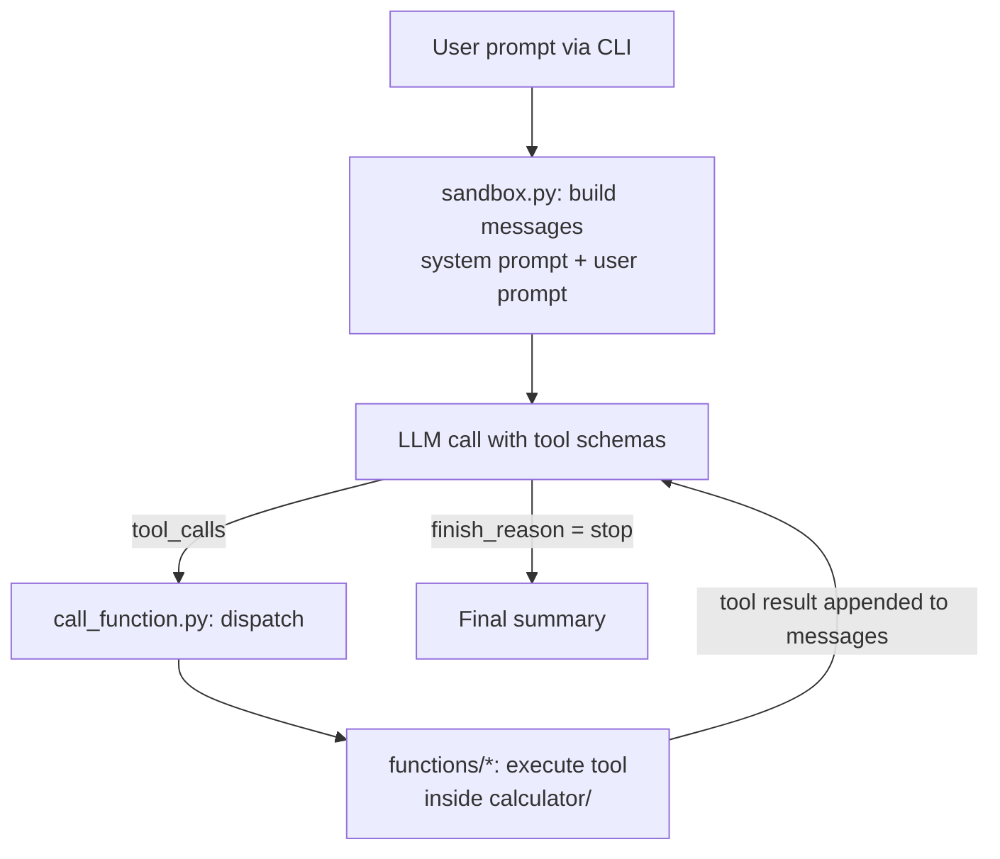

# Code Interpreter Agent

A minimal, from-scratch **tool-calling coding agent** in Python. Give it a task in plain English and it explores a working directory, reads and overwrites files, runs Python scripts, and reports what it did, all through an LLM function-calling loop built on the OpenAI-compatible API (no agent framework).

> Project 12 of my AI Agent Engineering portfolio.

## How it works



1. `sandbox.py` loads `config.toml`, picks the configured model, and creates an OpenAI-compatible client.
2. It sends the system prompt, the user prompt, and four tool schemas to the model.
3. If the model returns tool calls, `call_function.py` parses the JSON arguments, routes each call to the matching function, and the result is appended to the conversation as a `tool` message.
4. The loop repeats until the model stops (`finish_reason == "stop"`) or `MAX_LOOP` iterations are reached.

## Tools available to the agent

| Tool | Purpose |
|---|---|
| `get_file_info(dir)` | Lists files in a directory with sizes and whether each is a directory |
| `get_file_content(file_path)` | Reads a file, truncated at `MAX_CHARS` (10,000 by default) |
| `write_file(file_path, content)` | Overwrites an existing file (creating new files currently fails, see [Known issues](#known-issues)) |
| `run_python_file(file_path, args)` | Runs a `.py` file with optional CLI args (30 s timeout), returning stdout and stderr, plus the exit code when it is non-zero |

All tools operate relative to the working directory defined in `call_function.py` (`calculator/`). Each rejects paths that resolve outside it.

## Project structure

```
Project_12_Code_Interpreter_Agent/
├── sandbox.py            # Entry point: CLI + agent loop
├── call_function.py      # Dispatches model tool calls to Python functions
├── prompts.py            # System prompt
├── config.toml           # Loop limits and model/provider settings
├── tests.py              # Scratch script for calling tools directly
├── functions/
│   ├── get_file_info.py      # + schema_get_file_info
│   ├── get_file_content.py   # + schema_get_file_content
│   ├── write_file.py         # + schema_write_file
│   └── run_python_file.py    # + schema_run_python_file
└── calculator/           # The agent's working directory (sample target)
    ├── main.py           # Sample script (prints the odd numbers from 1 to 99)
    └── lorem.txt         # Sample text file
```

Each file in `functions/` holds both the implementation and the JSON schema the LLM sees.

## Getting started

### Prerequisites

- Python 3.11+ (uses the built-in `tomllib`)
- An API key for at least one provider listed below

### Install

```bash
git clone https://github.com/satyam-sharma7/Project_12_Code_Interpreter_Agent.git
cd Project_12_Code_Interpreter_Agent
python -m venv .venv
source .venv/bin/activate        # Windows: .venv\Scripts\activate
pip install openai python-dotenv
```

### Configure

Create a `.env` file in the project root (it is git-ignored) with the key for the model you select in `config.toml`:

```env
FREE_LLM_API=your_key_here
```

### Run

Run from the project root, since `config.toml` is read from the current directory:

```bash
python sandbox.py "Run main.py and tell me what it prints"
python sandbox.py "Add a function to main.py that computes the square of a number" --verbose
```

`--verbose` must be the second argument. It prints the user prompt, tool-call arguments and token usage.

## Configuration

`config.toml`:

```toml
MAX_LOOP  = 5        # max LLM iterations per run
MAX_CHARS = 10000    # max characters returned by get_file_content
MODEL     = "freellmapi"   # selects one of the [models.*] tables below
```

| Key | Provider / endpoint | Model | Env var for API key |
|---|---|---|---|
| `minmax` | OpenRouter | `minimax/minimax-m2.5:free` | `OPENROUTER_API_KEY` |
| `gemini` | Google AI Studio (OpenAI-compatible) | `gemini-3-flash-preview` | `GOOGLE_AI_STUDIO_3` |
| `glm` | Hugging Face router | `zai-org/GLM-5.1:fireworks-ai` | `HF_TOKEN` |
| `qwen` | Hugging Face router | `Qwen/Qwen3.6-35B-A3B:featherless-ai` | `HF_TOKEN_2` |
| `freellmapi` (default) | FreeLLMAPI proxy hosted on Render | `auto` | `FREE_LLM_API` |

Any OpenAI-compatible endpoint works: add a `[models.<name>]` table with `url`, `api` (env var name), `name`, `temperature`, `max_tokens`, then set `MODEL = "<name>"`.

## Design notes

- **No framework.** The agent loop, tool schemas, and dispatch are written by hand to show how function calling works end to end.
- **Provider-agnostic.** Switching models is a one-line change in `config.toml`.
- **Directory confinement.** Every tool resolves the requested path against the working directory and refuses anything outside it.
- **Prompted for caution.** The system prompt tells the model to inspect the workspace before editing, take one step at a time, avoid redundant calls, and summarize its actions at the end.

## Known issues

- **`write_file` cannot create new files.** For a file that doesn't exist yet, it calls `os.makedirs` on a parent directory that already exists, which raises `FileExistsError` and returns an error to the model. Overwriting existing files works.
- `tests.py` imports names that don't exist (`get_dir_info`, `file_content`, `write_code_file`, `run_code`) and will fail with an `ImportError`.
- `get_file_info`'s schema marks `dir` as required even though its description calls it optional.

## Limitations

- **Not a true sandbox.** `run_python_file` executes code with the host's `python` and your user's permissions. The path check and 30 s timeout limit where scripts live and how long they run, not what they can do. Run it only on code and prompts you trust, ideally inside a container or VM.
- The path check uses a string-prefix comparison, which can be bypassed by sibling directories sharing a prefix (e.g. `calculator_x`). `os.path.commonpath` is the safer approach.
- `get_file_content` and `write_file` use the platform's default text encoding.
- Conversation history is kept in memory for a single run only.

## Roadmap

- [ ] Fix `write_file` so it can create new files
- [ ] Replace the prefix path check with `os.path.commonpath`
- [ ] Isolate execution in Docker or a restricted subprocess
- [ ] Add a `requirements.txt` and real unit tests (`tests.py` currently contains scratch code)
- [ ] Add a flag to choose the working directory and model from the CLI
- [ ] Stream responses and print a cleaner final summary instead of raw message dumps

## License

No license has been specified yet.
